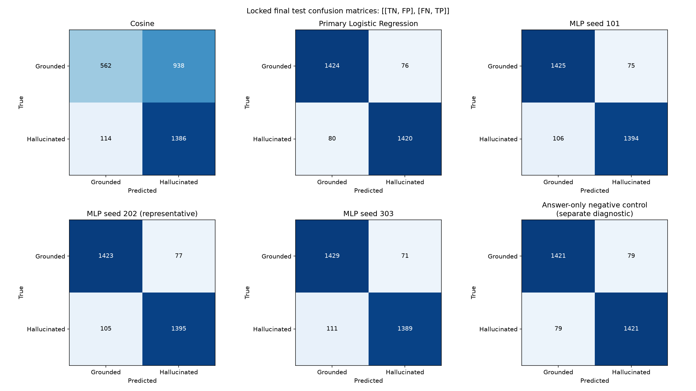
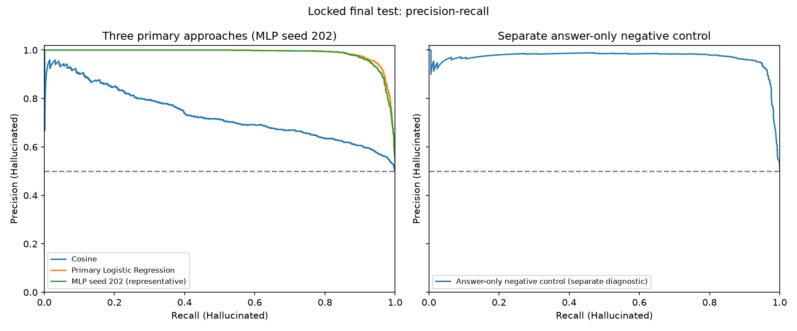

# Neural Hallucination Detector

Project overview
----------------
A focused, reproducible experiment to detect hallucinated answers in question-answering examples using frozen sentence embeddings and lightweight classifiers.

Research question
-----------------
On paired HaluEval-QA examples, can a lightweight MLP trained on frozen sentence-embedding interaction features detect hallucinated answers more effectively than a cosine-similarity threshold and Logistic Regression?

Dataset
-------
Source: HaluEval QA subset (official repository: https://github.com/RUCAIBox/HaluEval). The QA subset uses the file `data/qa_data.json` from the official repo.

Data acquisition (Phase 1)
-------------------------
A reproducible acquisition script is provided:

- python scripts/acquire_halueval.py

The script downloads the revision-pinned raw file from the official repository and writes it to `data/raw/qa_data.json` (newline-delimited JSON / NDJSON). The download process computes a SHA-256 checksum and writes a tracked provenance record at `data/metadata/halueval_qa_provenance.json`.

Raw-data Git policy
-------------------
- Downloaded raw data is stored under `data/raw/` and is excluded from Git by `.gitignore`.
- Small provenance and manifest files live under `data/metadata/` and are tracked in Git (see `data/metadata/halueval_qa_provenance.json`).

Leakage-safe methodology
------------------------
Split original records before paired expansion; keep both answers from each source record in the same split. Use a single documented split seed.

Features
--------
Primary feature vector: four 384-d interaction blocks and seven scalar features; total dimension = 1,543.

Models
------
- Cosine-similarity threshold baseline
- Logistic Regression baseline on the primary features
- Lightweight PyTorch MLP with architecture 1543 -> 256 -> 64 -> 1

Evaluation protocol
-------------------
Primary metric: F1 for the hallucinated class (label = 1). Test set is locked during development; use validation data for model selection and threshold tuning.

Results
-------
Phase 6 locked final test evaluation and shuffled-context analysis
-----------------------------------------------------------------
The single planned final evaluation completed on 3,000 examples from 1,500 test sources: 1,500 Grounded (`0`) and 1,500 Hallucinated (`1`). Every model used the identical example order. These are final test results; the Phase 4/5 tables below remain explicitly labeled validation selection-set results. No fitting, retuning, checkpoint selection, threshold adjustment, or representative-seed replacement occurred.

Before opening test inputs, the evaluator saved [the evaluation manifest](results/metrics/phase6/evaluation_manifest.json) with dataset/source, split-manifest, feature schema, preprocessing and scaler identities; Phase 4/5 reports and checkpoint checksums; fixed model choices and thresholds; seeds; and metric definitions. All 154 offline synthetic tests passed before the real evaluation. [The development smoke check](results/metrics/phase6/development_smoke.json) exactly reproduced every saved validation metric with no test inputs opened. The dedicated Phase 6 loader preserves the Phase 4/5 test-access guards. It checks IDs, paired variants, labels, class counts, stable source identities, split/context provenance, schema and scaler compatibility. Original test features were reconstructed exactly from compatible frozen caches before inference.

All threshold decisions come from validation artifacts: cosine direction **higher**, signed-score threshold `0.2736169099807739`; primary LR `C=0.01`, threshold `0.48363664746284485`; answer-only control `C=0.01`, threshold `0.46458989417782254`; MLP thresholds `0.512878954410553` (101), `0.3784696161746979` (202), and `0.5508548617362976` (303). Every prediction uses `score >= threshold`. ROC-AUC uses continuous hallucination scores: signed similarity for cosine and positive-class probabilities for LR/control/MLP. Precision, recall and F1 use Hallucinated as the positive class, with zero-division results set to zero.

| Approach (final test) | Accuracy | Precision (1) | Recall (1) | F1 (1) | ROC-AUC |
|---|---:|---:|---:|---:|---:|
| Cosine | 0.649333 | 0.596386 | 0.924000 | 0.724895 | 0.746504 |
| Primary Logistic Regression | 0.948000 | 0.949198 | 0.946667 | 0.947931 | 0.985544 |
| MLP seed 101 | 0.939667 | 0.948945 | 0.929333 | 0.939037 | 0.983103 |
| MLP seed 202 (representative) | 0.939333 | 0.947690 | 0.930000 | 0.938762 | 0.983063 |
| MLP seed 303 | 0.939333 | 0.951370 | 0.926000 | 0.938514 | 0.982918 |
| MLP three-seed mean | 0.939444 | 0.949335 | 0.928444 | 0.938771 | 0.983028 |
| MLP sample SD (ddof=1) | 0.000192 | 0.001871 | 0.002143 | 0.000262 | 0.000097 |

Separate answer-only style/length diagnostic:

| Accuracy | Precision (1) | Recall (1) | F1 (1) | ROC-AUC |
|---:|---:|---:|---:|---:|
| 0.947333 | 0.947333 | 0.947333 | 0.947333 | 0.974362 |

Seed **202** remains the representative run selected by median validation F1. Its metrics are a single run, separate from the three-seed mean and sample SD (`ddof=1`). Seed SD measures variation across these three training runs, not uncertainty over the benchmark population. The MLP did not outperform primary LR on final test F1 or ROC-AUC. The negative control is a separate answer-only style/length diagnostic and is not one of the three primary approaches.

Confusion matrices are `[[TN, FP], [FN, TP]]` (rows=true, columns=predicted; labels `[0,1]`):

| Model | Final test confusion matrix |
|---|---|
| Cosine | `[[562, 938], [114, 1386]]` |
| Primary Logistic Regression | `[[1424, 76], [80, 1420]]` |
| MLP seed 101 | `[[1425, 75], [106, 1394]]` |
| MLP seed 202 | `[[1423, 77], [105, 1395]]` |
| MLP seed 303 | `[[1429, 71], [111, 1389]]` |
| Answer-only negative control (separate diagnostic) | `[[1421, 79], [79, 1421]]` |






The existing [training/validation loss curves](results/figures/phase5_losses.png) remain unchanged.

Shuffled-context sanity results (fixed models)
---------------------------------------------
The evaluator saved primary metrics, predictions, comparison and plots, then wrote [their checksums](results/metrics/phase6/primary_saved.json) **before** generating the shuffle. The sole prespecified seed was **42**. The deterministic one-to-one mapping covers 1,500 sources with 1,490 normalized contexts (largest duplicate-context group: 2). It keeps normalized-context groups contiguous in a seeded order and rotates donor assignments by the largest group size. It fails if a context group exceeds half the sources, when this exclusion-constrained bijection is impossible. It never searches shuffles using model scores.

All integrity checks passed: no source keeps its own context; no replacement has the same normalized context, including duplicate-context matches; both answers receive the same donor context; donor IDs form a bijection; questions, answers, labels, IDs and row order stay unchanged; question-answer interactions and answer-only scalar features stay bitwise unchanged; the training scaler remains unchanged. The saved [mapping and checks](results/metrics/phase6/shuffled_context_mapping.json) contain identifiers only, without raw text.

Frozen cached question/answer embeddings and context chunks were reused without running or modifying the encoder. Existing Phase 3 utilities rebuilt every context-dependent feature, including answer-relevant chunk selection, four-block feature construction, maximum and top-three similarities, question-context similarity, content coverage and numeric coverage. The original training scaler and all model thresholds were applied unchanged. Only cosine, primary LR and representative MLP seed 202 were evaluated under the shuffle.

| Model / condition | Accuracy | Precision (1) | Recall (1) | F1 (1) | ROC-AUC |
|---|---:|---:|---:|---:|---:|
| Cosine / Original | 0.649333 | 0.596386 | 0.924000 | 0.724895 | 0.746504 |
| Cosine / Shuffled | 0.501333 | 0.535714 | 0.020000 | 0.038560 | 0.465869 |
| Cosine / Delta (shuffled minus original) | -0.148000 | -0.060671 | -0.904000 | -0.686335 | -0.280636 |
| Primary Logistic Regression / Original | 0.948000 | 0.949198 | 0.946667 | 0.947931 | 0.985544 |
| Primary Logistic Regression / Shuffled | 0.643333 | 0.584913 | 0.987333 | 0.734623 | 0.949069 |
| Primary Logistic Regression / Delta (shuffled minus original) | -0.304667 | -0.364285 | +0.040667 | -0.213308 | -0.036475 |
| MLP seed 202 (representative) / Original | 0.939333 | 0.947690 | 0.930000 | 0.938762 | 0.983063 |
| MLP seed 202 (representative) / Shuffled | 0.686333 | 0.616701 | 0.984667 | 0.758408 | 0.956576 |
| MLP seed 202 (representative) / Delta (shuffled minus original) | -0.253000 | -0.330989 | +0.054667 | -0.180354 | -0.026487 |

| Fixed model | Original confusion matrix | Shuffled confusion matrix |
|---|---|---|
| Cosine | `[[562, 938], [114, 1386]]` | `[[1474, 26], [1470, 30]]` |
| Primary Logistic Regression | `[[1424, 76], [80, 1420]]` | `[[449, 1051], [19, 1481]]` |
| MLP seed 202 (representative) | `[[1423, 77], [105, 1395]]` | `[[582, 918], [23, 1477]]` |

All three models lost F1 under this fixed shuffle. LR and the representative MLP gained recall while losing substantial precision at unchanged thresholds; their ROC-AUC remained high (`0.949069` and `0.956576`) despite unrelated contexts. This indicates sensitivity of their decisions to context replacement, while substantial ranking information remains in the unchanged question/answer inputs and benchmark artifacts. It does not establish that learned grounding caused their original performance, or identify a single causal shortcut. The strong answer-only control (test F1 `0.947333`) and documented length/style differences are serious concerns. Shuffling is a distribution shift and one prespecified sanity analysis, not a proof of real-world factual verification or a basis for model selection. The negative control was not rerun because its answer-only inputs are unchanged.

Phase 6 artifacts and reproduction
----------------------------------
Reusable inference/locking logic is in `src/hallucination_detector/evaluation.py`; orchestration and plots in `evaluation_pipeline.py`; cached feature recomputation and context mapping in `context_sanity.py`. The entry-point script is thin. Existing Phase 3/4/5 loaders, feature builders, scalers, metric utilities, checkpoints and reports are reused without changing their behavior.

From the repository root, after reproducing Phases 1–5 with the commands below:

```powershell
.venv\Scripts\python.exe -m pytest tests -q
.venv\Scripts\python.exe scripts/run_phase6.py --prepare
.venv\Scripts\python.exe scripts/run_phase6.py --evaluate
git diff --check
```

The runner intentionally refuses to overwrite an existing lock or repeat an evaluation attempt. For independent reproduction, use a separate checkout with its own data and checkpoints; preserve the tracked `results/metrics/phase6` and `results/figures/phase6` directories in a reference folder before these commands. Do not remove or replace this recorded evaluation for development. Reproduction uses the saved validation decisions and training artifacts, with CPU inference, one PyTorch thread, one BLAS thread and batch size 128. The ignored data caches, scaler and checkpoints must be acquired/reproduced locally; they are not bundled with Git.

Phase 6 outputs prepared for review (not yet committed):

- [Evaluation manifest](results/metrics/phase6/evaluation_manifest.json), [pre-test validation smoke](results/metrics/phase6/development_smoke.json), and [execution record](results/metrics/phase6/execution.json).
- [Final metrics and three-seed summary](results/metrics/phase6/primary_metrics.json), [comparison table](results/metrics/phase6/comparison.md), and [primary output checksums saved before shuffle](results/metrics/phase6/primary_saved.json).
- [Final predictions](results/metrics/phase6/primary_predictions.csv): 18,000 rows across six fixed runs. Columns: `example_id`, `source_id`, `true_label`, `continuous_score`, `predicted_label`, `model`, `seed` (blank when not applicable). No raw text is included.
- [Shuffled results with all original/shuffled metrics and deltas](results/metrics/phase6/shuffled_metrics.json), [source-to-donor mapping](results/metrics/phase6/shuffled_context_mapping.json), and [shuffled predictions](results/metrics/phase6/shuffled_predictions.csv): 9,000 rows across three fixed models.
- The three figures above; all were visually inspected. Seed 202 predictions are the handoff for later qualitative analysis; no Phase 7 errors were reviewed here.

Verification: the original suite passed 130 tests; the completed suite passed **154 tests** before final evaluation, with no skips. `git diff --check` passed. Exactly **one** real final evaluation and one fixed shuffled evaluation were performed, with **no reruns or implementation defects requiring reevaluation**. Matplotlib emitted a nonfatal permission warning while saving its font cache outside the repository; all requested figures were generated successfully. The existing unavailable (`null`) encoder revision remains a provenance limitation. Source, checkpoint, input and output checksums are preserved. No calibration, extra ablations, demo, deployment or Phase 7 analysis was added.


Qualitative error analysis
--------------------------
Phase 7 is complete: [all 20 reviewed cases and findings](results/error_analysis/phase7/report.md), [machine-readable reviewed table](results/error_analysis/phase7/reviewed_cases.json), [selection and input checksums](results/error_analysis/phase7/selection.json), and [multi-label category counts](results/error_analysis/phase7/category_counts.json).

Only original saved final-test predictions from representative MLP seed **202** were used, at its locked validation threshold **0.3784696161746979**. The ID join verifies source and label alignment across all 3,000 test examples. Available errors agree with the saved confusion matrix `[[1423,77],[105,1395]]`: **77 false positives** and **105 false negatives**. Selection takes the 10 FPs with highest scores and 10 FNs with lowest scores, breaking ties by ascending `example_id`. These are extreme model scores, not calibrated probabilities or proven confidence.

One analyst (the implementing assistant) read every selected question, answer and full provided context. Supported copied answers were sometimes rejected; date/entity mismatches were sometimes accepted. Two cases suggest label anomalies (one conditional on an ambiguous company referent), and several require unresolved attribution, naming or geographic evidence. The review distinguishes apparent model errors, label anomalies and unclear judgments without changing labels. Long supported FPs and short erroneous FNs are consistent with existing shortcut concerns, but the cases do not establish a causal feature mechanism. No chunk-selection failure is claimed. Deliberate extreme-score selection and a single analyst make these descriptive findings unsuitable as population estimates.

Reproduce selection and export from existing local processed test data and saved Phase 5/6 artifacts:

```powershell
.venv\Scripts\python.exe scripts/run_phase7.py
```

Reusable logic is in `src/hallucination_detector/error_analysis.py`; the thin command joins fixed predictions, checks saved decisions/provenance, and attaches the explicitly authored [analyst notes](results/error_analysis/phase7/analyst_notes.json). It validates verbatim excerpts and exact review coverage, then regenerates only Phase 7 exports. Full contexts and the complete test dataset are not exported. Qualitative judgments are preserved analyst work, not automatically inferred categories. No inference, retraining, retuning or new experiment occurs. Phase 6 artifact preservation is recorded in [the byte-check manifest](results/error_analysis/phase7/artifact_preservation.json). Phase 8 has not been implemented.

Reproduction instructions
------------------------
See configs/default.yaml for the canonical configuration, and tests/ for Phase 0–6 validation checks.

Environment setup
-----------------
- Python 3.12.0 (dedicated .venv at project root)
- Install: `pip install -r requirements.txt`
- Key packages: torch 2.14.0+cpu, sentence-transformers 6.0.1, scikit-learn 1.9.0

Phase 1 commands (data acquisition & audit)
------------------------------------------
- Acquire the official QA data and write provenance:
  - python scripts/acquire_halueval.py
- Validate original records and assign deterministic source IDs:
  - python scripts/validate_halueval.py
- Run the text-level audit and produce figures:
  - python scripts/audit_halueval.py
- Run duplicate audit:
  - python scripts/duplicate_audit.py

Phase 2 commands (leakage-safe splitting)
-----------------------------------------
- Create the original-record split manifest:
  - python scripts/create_split_manifest.py
- Expand records only after split assignment:
  - python scripts/expand_split_records.py
- Validate leakage and pairing invariants:
  - python scripts/validate_split_leakage.py

Phase 3 commands (frozen embeddings & features)
----------------------------------------------
- Run the full Phase 3 pipeline (encoding, chunking, feature generation, scaling):
  - python scripts/run_phase3.py
- Explicitly replace incompatible or stale embedding caches:
  - python scripts/run_phase3.py --force-recompute
- Generate the descriptive semantic-similarity audit from training data only:
  - python scripts/audit_train_similarity.py

Phase 3 methodology
-------------------
- Normalize each question, candidate answer, and reference context with `" ".join(text.split())`: require a string, strip outer whitespace, and collapse consecutive Unicode whitespace to one ordinary space. Apply this before deduplication, encoding, chunking, and scalar coverage calculation. Raw/processed source files, source/example IDs, splits, and labels are preserved.
- Preprocessing cache version: `2.0.0`; caches from the previous preprocessing version are rejected and require explicit regeneration with `--force-recompute`.
- Encoder: sentence-transformers/all-MiniLM-L6-v2 (frozen, 384-d, L2-normalized)
- Context chunking: 192 model tokens per chunk, 32-token overlap, tokenizer-aware
- Primary feature vector (dim=1,543):
  - 4 interaction blocks (384 each): |a - c_a|, a * c_a, |q - a|, q * a
  - 7 scalar features: max answer-context cosine, mean top-3 answer-context cosine, question-answer cosine, max question-context cosine, answer content-token coverage, answer numeric-token coverage, numeric-token presence
- Scaling: StandardScaler fit on training data only, applied to all splits

Phase 3 artifacts
-----------------
- data/features/{train,validation,test}/features.npy — raw features (N, 1543)
- data/features/{train,validation,test}/features_scaled.npy — scaled features (N, 1543)
- data/features/{train,validation,test}/labels.npy — binary labels
- data/features/{train,validation,test}/example_ids.json — stable example IDs
- data/features/{train,validation,test}/source_ids.json — source record IDs
- data/features/{train,validation,test}/metadata.json — per-split stats
- data/features/schema.json — feature schema with block boundaries and scalar indices
- data/scaler/scaler.npz — fitted scaler parameters (mean, scale)
- data/embedding_cache/ — compatible question, answer, context, and chunk embeddings with metadata

Phase 3 cache policy
--------------------
- Compatible embedding caches are validated and reused.
- Incomplete or incompatible caches fail clearly instead of being silently mixed or replaced.
- `--force-recompute` explicitly refreshes all embedding caches.
- Embedding caches, feature matrices, fitted scaler artifacts, and `.venv` are excluded from Git.

Provenance location
-------------------
Tracked provenance metadata is written to `data/metadata/halueval_qa_provenance.json`.

Phase 1 results (actual acquisition performed)
---------------------------------------------
- Official source: https://github.com/RUCAIBox/HaluEval (file: data/qa_data.json)
- Source revision: 207f479c555a68b8d2431631a95083b84b2accbe
- Local raw path: data/raw/qa_data.json
- SHA-256 checksum: 89ed139ec5e3a3169a0b30e45569ac1283846f76f27f7bb5e908ee6deed57e88
- Raw record count: 10,000
- Validation: 10,000 valid records, 0 excluded

Observed shortcut-risk signals (text-level, Phase 1)
---------------------------------------------------
Preliminary text-level audit (no embeddings) shows noticeable differences between grounded and hallucinated answers:
- Grounded answers are typically short (token mean ≈ 2.22, median 2), with high lexical overlap with the context (mean lexical coverage ≈ 0.897).
- Hallucinated answers are longer on average (token mean ≈ 10.99, median 9) and have lower lexical overlap with the context (mean lexical coverage ≈ 0.628).

These observations suggest potential shortcut risks based on answer length and lexical overlap. Phase 3 now supplies the frozen-embedding similarity features used by the primary models.

Train-only semantic-similarity audit (Phase 3)
---------------------------------------------
`python scripts/audit_train_similarity.py` compares the unscaled maximum answer-context-chunk cosine by label using only `data/features/train/features.npy` and training labels. It writes aggregate counts, means, population standard deviations, quartiles, and ranges to `results/metrics/halueval_train_semantic_audit.json` and a comparison histogram to `results/figures/train_answer_context_cosine.png`.

After normalized regeneration, each training class contains 7,000 examples. Grounded answers have mean cosine 0.3611 (median 0.3731; population SD 0.2111), while hallucinated answers have mean 0.5628 (median 0.5838; population SD 0.1882). Hallucinated answers therefore have higher similarity on average in this training split, contrary to the cosine baseline's original expected direction. The distributions overlap substantially; the earlier answer-length differences are a possible contributing benchmark artifact, not an established explanation. The feature design remains unchanged; the user subsequently authorized validation-only selection between both cosine directions in Phase 4.

This descriptive audit does not calculate test performance or change the locked feature design. Differences may reflect grounding and benchmark shortcuts; they do not establish causality or generalization.

Phase 4 baselines and negative control (validation only)
-------------------------------------------------------
Run from the repository root: `.venv\Scripts\python.exe scripts/run_phase4.py`.
Run all tests: `.venv\Scripts\python.exe -m pytest tests -q`.

The Phase 4 workflow opens training and validation features only (14,000 and 3,000 paired examples, respectively). It refuses test split inputs. Training rows fit the models; validation alone selects cosine direction/threshold, Logistic Regression regularization, and probability thresholds. No model is refitted on combined train/validation data. These are selection-set results, not final test estimates.

- Cosine: unscaled `max_answer_context_cosine` at column 1536. Both directions are searched as explicitly authorized after the training audit. The selected rule is **Hallucinated when similarity >= 0.2736169099807739**, with continuous score equal to similarity for ROC-AUC. Selecting the higher-similarity direction may reflect HaluEval construction artifacts; it does not establish a general rule about grounding.
- Primary Logistic Regression: L2, shared saved scaled 1,543 features, `C` in `[0.01, 0.1, 1, 10]`, no class weights, deterministic `lbfgs`, seed 42, maximum 5,000 iterations, tolerance `1e-5`, one BLAS thread. Selected `C=0.01`, probability threshold `0.48363664746284485`.
- Negative control: separate L2 Logistic Regression with answer character count, whitespace-token count, lightweight sentence count, numeric-token presence/count, and Unicode punctuation count. Features use original processed answer strings. A separate StandardScaler fits on training control features only. Question/context data, semantic features, coverage, and IDs are excluded as predictors. Selected `C=0.01`, probability threshold `0.46458989417782254`. This diagnostic is not a primary model.

Thresholds use `score >= threshold`; lower-cosine direction uses `score=-similarity`, equivalent to `similarity <= threshold`. Candidates are distinct validation scores, a reference (0.5 for probabilities, 0 for signed cosine), and the next representable value above the maximum. Ties prefer proximity to the reference, then smaller threshold. Direction ties prefer the original lower-similarity direction. Logistic model selection orders by highest validation F1, highest validation ROC-AUC, smaller C, threshold closest to 0.5, then smaller threshold.

| Approach (validation only) | Accuracy | Precision (1) | Recall (1) | F1 (1) | ROC-AUC |
|---|---:|---:|---:|---:|---:|
| Cosine | 0.6457 | 0.5948 | 0.9140 | 0.7206 | 0.7542 |
| Primary Logistic Regression | 0.9493 | 0.9469 | 0.9520 | 0.9495 | 0.9889 |
| Answer-only negative control | 0.9537 | 0.9516 | 0.9560 | 0.9538 | 0.9767 |

All eight Logistic Regression candidate fits converged. Primary iterations for C `[0.01, 0.1, 1, 10]`: `[35, 60, 109, 132]`; control iterations: `[16, 19, 22, 25]`. Continuous probabilities, not thresholded predictions, determine Logistic Regression ROC-AUC.

The strong answer-only result, together with the large answer-length difference (Phase 1 token means approximately 2.22 versus 10.99), is a serious benchmark shortcut concern. High validation performance cannot be attributed solely to context grounding. These results do not establish real-world hallucination detection or a final model ranking.

Tracked configuration, complete C searches, cosine direction search, validation metrics/confusion matrices, control feature schema/scaler parameters, library versions, and input provenance are in `results/metrics/phase4_validation.json`. Fitted estimators, both scaler parameter sets, and selected rules are saved without raw text in ignored `checkpoints/phase4/baselines.joblib`. Only trusted local joblib checkpoints should be loaded; the loader checks feature schema and preprocessing compatibility. No final test evaluation, MLP, shuffled-context evaluation, or error analysis has been run in Phase 4.

Phase 5 MLP training (validation only)
-------------------------------------
From the repository root, with the existing Phase 3 artifacts and Phase 4 validation report:

```powershell
.venv\Scripts\python.exe scripts/run_phase5.py
.venv\Scripts\python.exe -m pytest tests -q
```

The runner uses only the saved training-scaled 1,543-dimensional training and validation matrices (14,000 and 3,000 examples). Before training, it verifies the canonical schema, preprocessing version, dataset/source and split provenance, embedding metadata, IDs and labels, and unchanged Phase 4 input checksums. Phase 4 already verified the scaler against training moments; Phase 5 checks its identity and verifies both saved scaled matrices against its transformation. It never fits another scaler, regenerates embeddings, or opens test features/labels.

The locked network is `1543 -> Linear(256) -> ReLU -> Dropout(0.20) -> Linear(64) -> ReLU -> Dropout(0.10) -> Linear(1)`, returning raw logits. Training uses unweighted BCEWithLogitsLoss, AdamW, numeric learning rate `0.001`, weight decay `0.0001`, batch size 128, maximum 30 epochs, and patience 5. Both epoch losses are weighted by batch sample counts, including incomplete final batches. Validation uses evaluation/inference mode. Strictly lower validation loss saves the best checkpoint; equal losses retain the earlier epoch. Each run restores that checkpoint before sigmoid prediction and validation-only F1 threshold selection using the existing Phase 4 utility and tie rules.

The three runs seed Python, NumPy, PyTorch, and an independent training DataLoader generator. Only training batches shuffle. This execution used CPU, one PyTorch compute thread, no loader workers, deterministic algorithms enabled, cuDNN deterministic enabled and benchmark disabled. Exact library versions, execution settings, code hashes, and input hashes are recorded in the summary. Reproducibility applies to the same software/hardware settings; bitwise identity across platforms is not guaranteed.

**Validation selection-set results, not final test estimates:**

| Seed | Accuracy | Precision (1) | Recall (1) | F1 (1) | ROC-AUC | Threshold | Best epoch |
|---|---:|---:|---:|---:|---:|---:|---:|
| 101 | 0.940000 | 0.937666 | 0.942667 | 0.940160 | 0.984600 | 0.512878954410553 | 2 |
| 202 | 0.940333 | 0.941216 | 0.939333 | 0.940274 | 0.984942 | 0.3784696161746979 | 2 |
| 303 | 0.943667 | 0.944556 | 0.942667 | 0.943610 | 0.984750 | 0.5508548617362976 | 2 |
| Mean | 0.941333 | 0.941146 | 0.941556 | 0.941348 | 0.984764 | — | — |
| Sample SD | 0.002028 | 0.003446 | 0.001925 | 0.001960 | 0.000171 | — | — |

Standard deviations use `ddof=1` across the three seeds. All three stopped after epoch 7, following five epochs without improvement after epoch 2. Best validation BCE losses were 0.1642051882, 0.1608461339, and 0.1676170768 for seeds 101, 202, and 303, respectively. Confusion matrices (rows=true, columns=predicted, labels `[0,1]`) were `[[1406,94],[86,1414]]`, `[[1412,88],[91,1409]]`, and `[[1417,83],[86,1414]]`.

The representative seed is **202**, selected by median validation F1; exact F1 ties choose the smaller seed. All three models are preserved. These MLP validation scores are below the Phase 4 primary Logistic Regression and answer-only negative control scores. The strong answer-only control and documented answer-length and semantic-similarity differences remain serious shortcut concerns: these results alone do not establish context grounding, real-world generalization, or a final model ranking. No architecture or hyperparameters were changed in response to results.

Artifacts:

- `results/metrics/phase5_validation.json`: all seed metrics, thresholds, best epochs, aggregate mean/sample SD, selection policies, configuration, library versions, and provenance.
- `results/metrics/phase5/seed_{101,202,303}_history.json`: complete epoch histories, tracked with the summary.
- `results/figures/phase5_losses.png`: tracked training/validation loss curves for all seeds.
- `checkpoints/phase5/mlp_seed_{101,202,303}.pt`: ignored independent best state dictionaries, thresholds, configuration, and compatibility metadata. Reload uses PyTorch's restricted `weights_only=True` loader and checks schema, preprocessing, scaler and input provenance.


The existing encoder metadata records its revision as unavailable (`null`); Phase 5 preserves that limitation and does not reload the encoder. The run also emitted a nonfatal Matplotlib font-cache permission warning; the loss figure was generated successfully. Phase 5 itself stops at validation. Phase 6 final test and shuffled-context outputs and Phase 7 qualitative error analysis are documented above.

Repository structure
--------------------
See PROJECT_PLAN.md for the recommended structure. Key folders:
- configs/: canonical experiment configuration
- data/: raw and processed data (excluded from git)
- src/: reusable code under src/hallucination_detector/
- tests/: phase-specific unit tests
- results/: generated figures, metrics, and error analyses

Limitations
-----------
These results apply to paired HaluEval-QA with a balanced, duplicate-context-grouped split. They do not establish reliable grounding detection for arbitrary LLM answers, unseen domains, different generation styles, real-world class distributions or deployment. The threshold, linear and nonlinear primary approaches all use frozen neural sentence embeddings. The near-matching answer-only negative control and high shuffled-context ROC-AUC suggest substantial benchmark shortcuts; strong benchmark scores cannot be attributed solely to contextual grounding. Chunk selection may miss relevant evidence, and the frozen 384-dimensional representation has limited factual resolution; Phase 7 does not demonstrate any chunk-selection failure. Three-seed sample SD describes run variation only. Phase 7 reviews deliberately selected extreme-score errors with one analyst; clean-environment reproduction remains Phase 8 work. The encoder revision was not available in the inherited metadata.

References
----------
- HaluEval: https://github.com/RUCAIBox/HaluEval
- Project plan and methodology: PROJECT_PLAN.md
