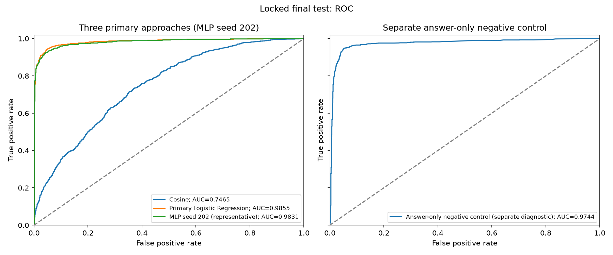

# Neural Hallucination Detector

A research comparison on paired **HaluEval QA**: does a lightweight nonlinear MLP over frozen sentence-embedding interactions detect hallucinated answers better than a cosine threshold or Logistic Regression?

## Main findings

- **Logistic Regression outperformed the MLP on this benchmark:** final-test hallucinated-class F1 was **0.947931**, compared with **0.938771** for the three-seed MLP mean.
- The separate **answer-only negative control nearly matched primary LR** (F1 **0.947333**), raising substantial answer-style shortcut concerns.
- **Shuffled-context ranking performance remained high:** LR ROC-AUC **0.949069**, representative MLP **0.956576**, despite unrelated contexts. Their fixed-threshold F1 scores decreased.
- **Benchmark performance does not establish reliable general-purpose grounding detection.** No statistical significance claim is made.

## Dataset and leakage prevention

The official QA file contains **10,000 original records**, all valid, with no exclusions. Each record supplies a question, reference knowledge, grounded answer, and generated hallucinated answer. Labels are **0 = Grounded; 1 = Hallucinated**; Hallucinated is the positive class.

Validation, deterministic SHA-256 source IDs, and duplicate auditing precede splitting. Identical normalized contexts form groups that remain in one split. Original records are split **70/15/15, seed 42**, then each source expands into its two answers. The achieved counts are 7,000/1,500/1,500 sources and **14,000/3,000/3,000 examples**, exactly balanced within each split. Assertions check source/context separation, complete manifest coverage, paired variants, deterministic unique IDs, labels, and split determinism.

See the [pinned data provenance](data/metadata/halueval_qa_provenance.json), [validation report](data/metadata/halueval_validation_report.json), [duplicate audit](results/metrics/halueval_duplicate_audit.md), [original-record split manifest](data/splits/halueval_original_split_manifest.json), and [leakage report](data/splits/halueval_split_leakage_report.json).

## Frozen encoder and 1,543-feature architecture

`sentence-transformers/all-MiniLM-L6-v2` remains frozen and produces **384-dimensional L2-normalized embeddings**. Encoder input only collapses whitespace, preserving case, punctuation, numbers, and negation. Contexts use tokenizer-aware **192-token chunks with 32-token overlap**. For question `q` and answer `a`, `c_a` is the chunk with maximum answer cosine similarity.

The shared primary representation is:

```text
|a - c_a|  +  a ⊙ c_a  +  |q - a|  +  q ⊙ a     4 × 384 = 1,536
seven scalar features                                      + 7
total                                                    1,543
```

The scalars are maximum answer–chunk cosine, mean top-three answer–chunk cosine (all available if fewer than three), question–answer cosine, maximum question–chunk cosine, answer content-token coverage, answer numeric-token coverage, and numeric-token presence. Numeric coverage/presence are zero without numeric tokens. Scaling fits **training rows only** and is reused unchanged. Standalone answer length/style features are excluded from this representation. See the [feature schema](configs/feature_schema.json) and [canonical configuration](configs/default.yaml).

## Three primary approaches and separate negative control

1. **Cosine threshold** over maximum answer–chunk similarity. Following the documented training audit, validation-only selection between both directions was explicitly authorized. The saved rule predicts Hallucinated for similarity **>= 0.2736169099807739**; higher similarity was selected on this benchmark, contrary to the original expected grounding direction.
2. **Logistic Regression** over the scaled 1,543 features, L2 regularization, validation search `C ∈ {0.01, 0.1, 1, 10}`. Selected `C=0.01`, threshold **0.48363664746284485**.
3. **PyTorch MLP**, `1543 → 256 → 64 → 1`, ReLU, dropout 0.20/0.10, `BCEWithLogitsLoss`, AdamW (`lr=1e-3`, weight decay `1e-4`), batch 128, maximum 30 epochs, patience 5. Lowest validation loss selects checkpoints; validation F1 selects thresholds. Seeds are **101, 202, 303**. All three best checkpoints were epoch 2; training stopped at epoch 7. Seed **202** is the median-validation-F1 representative, selected before test evaluation.

All three approaches use frozen neural embeddings. The **separate negative control** is LR on six answer-only surface features: character, whitespace-token and sentence counts, numeric-token presence/count, and punctuation count. It receives no question/context information. Its scaler fits training answers only; validation selects `C=0.01` and threshold **0.46458989417782254**.

The [Phase 4 report](results/metrics/phase4_validation.json) and [Phase 5 report](results/metrics/phase5_validation.json) contain **validation selection-set results**, searches, thresholds, versions, and provenance. They are not final-test estimates. Validation F1 was 0.9495 for primary LR (rounded as previously reported) and 0.941348 for the MLP three-seed mean. The [training-only similarity audit](results/metrics/halueval_train_semantic_audit.json) records the unexpected cosine direction.

## Final test results

The single locked evaluation used the same **3,000 test examples** for every model (1,500 per class). No test-based fitting, tuning, checkpoint/threshold selection, or representative-seed replacement occurred. ROC-AUC uses continuous hallucination scores; classification uses `score >= threshold`. Values below retain the saved six-decimal reporting precision.

| Approach (final test) | Accuracy | Precision (1) | Recall (1) | F1 (1) | ROC-AUC |
|---|---:|---:|---:|---:|---:|
| Cosine | 0.649333 | 0.596386 | 0.924000 | 0.724895 | 0.746504 |
| Primary Logistic Regression | 0.948000 | 0.949198 | 0.946667 | 0.947931 | 0.985544 |
| MLP seed 101 | 0.939667 | 0.948945 | 0.929333 | 0.939037 | 0.983103 |
| MLP seed 202 (representative) | 0.939333 | 0.947690 | 0.930000 | 0.938762 | 0.983063 |
| MLP seed 303 | 0.939333 | 0.951370 | 0.926000 | 0.938514 | 0.982918 |
| MLP three-seed mean | 0.939444 | 0.949335 | 0.928444 | 0.938771 | 0.983028 |
| MLP sample SD (ddof=1) | 0.000192 | 0.001871 | 0.002143 | 0.000262 | 0.000097 |

Separate answer-only style/length diagnostic:

| Accuracy | Precision (1) | Recall (1) | F1 (1) | ROC-AUC |
|---:|---:|---:|---:|---:|
| 0.947333 | 0.947333 | 0.947333 | 0.947333 | 0.974362 |

The sample SD (`ddof=1`) describes variation across **these three training seeds**. It is neither population uncertainty nor a confidence interval. Representative seed 202 is a single run, distinct from the mean.




Full [metrics and confusion matrices](results/metrics/phase6/primary_metrics.json), [predictions](results/metrics/phase6/primary_predictions.csv), [confusion-matrix figure](results/figures/phase6/confusion_matrices.png), [precision–recall curves](results/figures/phase6/precision_recall.png), [comparison table](results/metrics/phase6/comparison.md), and [pre-test evaluation lock](results/metrics/phase6/evaluation_manifest.json) remain available.

## Shuffled-context sanity test

After saving primary outputs and their checksums, a single deterministic shuffle (seed **42**) replaced contexts across test sources. No source retained its own source/context group; both answers shared one donor context, and donors formed a bijection. Frozen caches rebuilt context-dependent features; models, training scaler, thresholds, questions and answers stayed fixed. No model was retrained or retuned. The answer-only control was not rerun because its inputs were unchanged.

| Fixed model | Original F1 | Shuffled F1 | F1 change | Original ROC-AUC | Shuffled ROC-AUC | AUC change |
|---|---:|---:|---:|---:|---:|---:|
| Cosine | 0.724895 | 0.038560 | -0.686335 | 0.746504 | 0.465869 | -0.280636 |
| Primary Logistic Regression | 0.947931 | 0.734623 | -0.213308 | 0.985544 | 0.949069 | -0.036475 |
| MLP seed 202 | 0.938762 | 0.758408 | -0.180354 | 0.983063 | 0.956576 | -0.026487 |

Changes are shuffled minus original, rounded from saved full-precision values. LR/MLP recall increased while precision fell at unchanged thresholds. Their high remaining ranking performance and the strong answer-only control raise shortcut concerns, without identifying a causal mechanism. Context shuffling is a distribution shift, not proof of factual verification. See [full shuffled metrics](results/metrics/phase6/shuffled_metrics.json) and [mapping/integrity checks](results/metrics/phase6/shuffled_context_mapping.json).

## Qualitative findings

The [Phase 7 report](results/error_analysis/phase7/report.md) reviews **10 highest-score false positives and 10 lowest-score false negatives** from saved original seed-202 predictions, selected from 77 FPs and 105 FNs. One analyst reviewed every selected question, answer, and full provided context. Supported copied answers were sometimes rejected; date/entity mismatches were sometimes accepted. Two cases suggest label anomalies (one conditional on an ambiguous company referent); other judgments remain unclear. Labels were preserved.

The [reviewed cases](results/error_analysis/phase7/reviewed_cases.json), [analyst notes](results/error_analysis/phase7/analyst_notes.json), and [category counts](results/error_analysis/phase7/category_counts.json) preserve evidence and rationale. Extreme-score selection and one analyst make these descriptive findings unsuitable as population estimates. Scores are not calibrated confidence. No chunk-selection failure was demonstrated.

## Installation and reproduction

The tested interpreter is **CPython 3.12.0 on Windows AMD64**. Packaging requires Python >=3.10; other Python/platform combinations have not been verified. Use a repository-root **editable installation**, because configuration and scripts live outside the Python package. CPU execution is supported; the saved MLP/evaluation used CPU with one PyTorch thread and one BLAS thread. The encoder defaults to CUDA when available, otherwise CPU.

From the repository root in PowerShell:

```powershell
py -3.12 -m venv .venv
.venv\Scripts\python.exe -m pip install -c constraints-tested.txt -e .
.venv\Scripts\python.exe -m pip check
.venv\Scripts\python.exe -m pytest tests -q
.venv\Scripts\python.exe scripts/run_phase6.py --help
```

Use a new environment if `.venv` already holds work you need to retain. On POSIX, use `python3.12 -m venv .venv` and `.venv/bin/python` (not verified here). Installation downloads packages unless cached. The tests use synthetic fixtures and mocked encoders/downloads; they need neither HaluEval nor MiniLM downloads.

See the [reproduction guide](docs/REPRODUCING.md) for stage commands, local ignored artifacts and their generation order, evaluation protection, and qualitative export. [Observed dependency versions](docs/environment-observed.json) and [direct-dependency constraints](constraints-tested.txt) record the inherited environment; they are not a universal/transitive lock. The [Phase 8 verification report](docs/PHASE8_VERIFICATION.md) separates main-environment and clean-environment outcomes.

Phase 8 verified a fresh independent run from checksum-verified raw data through feature generation, training, one locked test evaluation, and one context shuffle. The primary and shuffled prediction CSVs matched the published files byte for byte. All 20 selected cases and their evidence matched the historical qualitative reviews. The full offline suite passed **189 tests**. See the [verification record](docs/PHASE8_VERIFICATION.md).

## Limitations

- Balanced paired HaluEval QA differs from arbitrary LLM answers, unseen domains, new generation styles, and real-world class distributions. Benchmark performance does not establish reliable general-purpose grounding detection.
- Answer-generation style is a substantial shortcut concern; the answer-only control nearly matches primary LR. High shuffled-context ROC-AUC cannot establish contextual grounding.
- Frozen 384-dimensional embeddings and answer-relevant chunk selection can miss factual distinctions or relevant evidence; the reviewed cases do not demonstrate a chunk-selection failure.
- Three-seed SD measures run variation only. No significance test, population uncertainty estimate, calibration, or cross-dataset validation was performed.
- Encoder revision is **unavailable (`null`)** in the inherited cache metadata. The independent run recorded its own verified encoder revision. The published weights cannot be identified from the historical metadata, and the verified match on this environment does not guarantee byte-identical results across platforms.
- Checkpoints, raw/processed data, features, scaler, and embedding caches are ignored local artifacts and are not supplied by Git. A source checkout alone cannot reproduce saved inference without regenerating or obtaining compatible artifacts.

## Repository structure

```text
configs/                     canonical YAML and feature schema
src/hallucination_detector/   reusable data, features, baselines, MLP, evaluation, analysis
scripts/                     thin stage commands
tests/                       offline synthetic tests
data/metadata/, data/splits/  tracked provenance, IDs, manifests and leakage reports
data/{raw,processed,embedding_cache,features,scaler}/  ignored local artifacts
checkpoints/                 ignored baseline and MLP checkpoints
results/                     tracked metrics, predictions, figures and qualitative reviews
docs/                        reproduction and verification records
```

[PROJECT_PLAN.md](PROJECT_PLAN.md) is the methodological source of truth; [AGENTS.md](AGENTS.md) defines implementation conduct. The existing cosine-direction exception is documented in the Phase 4 artifacts; Phase 8 changes no research decisions.

## Citations and licensing

- Junyi Li, Xiaoxue Cheng, Wayne Xin Zhao, Jian-Yun Nie, and Ji-Rong Wen (2023). [HaluEval: A Large-Scale Hallucination Evaluation Benchmark for Large Language Models](https://aclanthology.org/2023.emnlp-main.397/), EMNLP, pp. 6449–6464. [Official repository](https://github.com/RUCAIBox/HaluEval).
- Nils Reimers and Iryna Gurevych (2019). [Sentence-BERT: Sentence Embeddings using Siamese BERT-Networks](https://aclanthology.org/D19-1410/), EMNLP-IJCNLP, pp. 3982–3992.
- The exact encoder is described by its [all-MiniLM-L6-v2 model card](https://huggingface.co/sentence-transformers/all-MiniLM-L6-v2), which lists **Apache-2.0**. Sentence-BERT is the framework reference, not a claim that the 2019 paper released this exact checkpoint.

The [HaluEval upstream license](https://github.com/RUCAIBox/HaluEval/blob/main/LICENSE) is **MIT**, consistent with the tracked provenance. Upstream describes QA as based on HotpotQA, with Wikipedia knowledge and generated hallucinated answers; upstream repository licensing does not by itself resolve every underlying content right. Raw data and encoder weights are acquired separately, not bundled here. This project has no repository-level `LICENSE` file; no license for the project's own code is asserted by these third-party statements.
